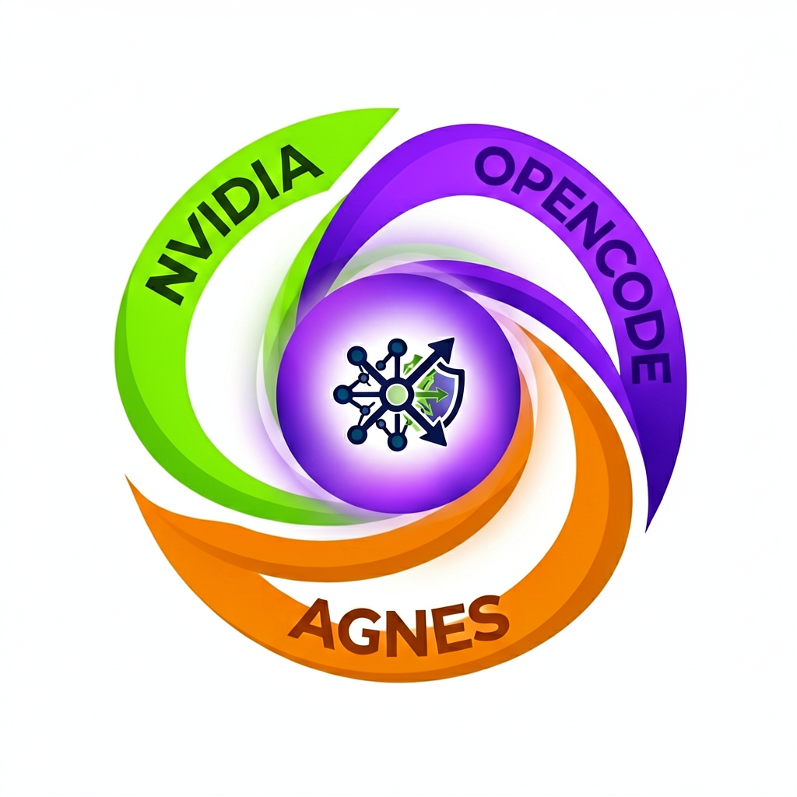

# AI Proxy Gateway

<p align="center">
  
</p>

<p align="center">
  <a href="https://hub.docker.com/r/litellm/litellm"></a>
  <a href="https://claude.com/product/claude-code"></a>
  <a href="https://build.nvidia.com/"></a>
  <a href="https://ai.google.dev/"></a>
  <a href="https://www.python.org/"></a>
  <a href="https://www.docker.com/"></a>
  <a href="https://docs.docker.com/compose/"></a>
</p>

An AI Proxy Gateway that routes **Claude Code** and other clients through **LiteLLM** to multiple AI backend providers (NVIDIA NIM, Agnes AI, SenseNova, Google Gemini) with load balancing and cascading fallbacks. Runs as a **single-worker** instance (`--num_workers 1`, supervised by Gunicorn) so the router's cooldown/usage counters apply to every request — no Postgres/Redis required. Sized at 1 vCPU / 3 GB to leave room on the host for other services. Binds on `0.0.0.0:4000`; host network must isolate this port. Runs on the pinned `litellm 1.105.1` base image, whose Anthropic streaming adapter is verified at build time against the Nemotron thinking-stream defects that previously required a local source patch.

---

## Features

- **Multi-Provider Routing**: Access NVIDIA NIM, Agnes AI, SenseNova, and Google Gemini endpoints through unified virtual model names with cascading fallbacks and usage-based load balancing.
- **Load Balancing**: `simple-shuffle` (`routing_strategy` in `litellm/config.yaml`) routes to the least-utilized deployment per worker. Every alias holds two deployments — the two NVIDIA NIM aliases use two API keys each, `claude-sonnet-5` pairs Agnes AI with SenseNova, and both Gemini aliases use two keys — so all five spread load across two endpoints.
- **Cascading Fallbacks**: every Claude alias follows the same ordered cascade —
  1. `gemini-3.5-flash-lite`
  2. `gemini-3.1-flash-lite`
- **Parameter Normalization**: Drops unsupported parameters (`drop_params: true`) for cross-provider compatibility.
- **Tool Compatibility**: Automatically strips `strict: null` from tool definitions (`additional_drop_params` on every Gemini deployment) for backends that reject non-boolean values.
- **Lean Health Check**: Container liveness uses a stdlib `urllib` probe (no `curl`/`requests` dependency), with a 180s start period (a cold start measured 129s) and 30s interval.
- **Resource-Tuned Container**: Pinned to 1 CPU / 3 GB RAM — measured at 1.05 GB idle and 1.40 GB under mixed traffic, since LiteLLM's 4 GB-per-worker floor is driven by its database engine and this deployment runs none — with 10 MB × 3 log rotation.
- **Gunicorn-Supervised Worker**: `--run_gunicorn`, because uvicorn's own multiprocess manager pings each child with a hard-coded 5s timeout and kills workers that are still importing LiteLLM (measured: a 2-worker uvicorn boot killed 14 workers and took 129s to first liveliness, against 29s under Gunicorn).
- **Build-Gated Streaming Image**: Builds `litellm-proxy:patched` on the pinned `litellm 1.105.1` base image, where the Nemotron thinking-stream defects that used to need a local source patch are fixed upstream. The build replays the failing chunk shape against the installed adapter and aborts if the behavior regresses.
- **Single-Worker Design**: One worker process (`--num_workers 1`) under Gunicorn. In-memory state (router cooldowns, usage counters, request spend) is shared by every request, which the multi-worker setup could not do without Redis. No external database, Redis, or UI required.
- **Health Checks**: Liveness (`/health/liveliness`) and readiness (`/health/readiness`) endpoints.
- **Lean Build Context**: `.dockerignore` excludes `.env`, `.env.*`, `.git/`, `.claude/`, all markdown (`*.md`), images (`logo.png`), docker compose files (`docker-compose*.yml`), and caches from the Docker build context.

---

## Architecture & Model Mapping

| Virtual Model Alias         | Backend Deployments                                                                  | Routing & Limits                                                     |
| :-------------------------- | :----------------------------------------------------------------------------------- | :------------------------------------------------------------------- |
| `claude-opus-5`             | • `nvidia_nim/nvidia/nemotron-3-super-120b-a12b` (Key 1)<br>• `nvidia_nim/nvidia/nemotron-3-super-120b-a12b` (Key 2) | Load-balanced; 40 RPM per deployment; 60s per-attempt timeout |
| `claude-sonnet-5`           | • `openai/agnes-2.5-flash` (Agnes AI, `AGNES_API_KEY`)<br>• `openai/sensenova-6.8-flash-lite` (SenseNova, `SENSENOVA_API_KEY`) | Load-balanced; 20 RPM per deployment        |
| `claude-haiku-4-5-20251001` | • `nvidia_nim/nvidia/nemotron-3.5-super-vl-120b-a12b` (Key 1)<br>• `nvidia_nim/nvidia/nemotron-3.5-super-vl-120b-a12b` (Key 2) | Load-balanced; 40 RPM per deployment      |
| `gemini-3.5-flash-lite`     | • `gemini/gemini-3.5-flash-lite` (Key 1)<br>• `gemini/gemini-3.5-flash-lite` (Key 2) | Load-balanced; declarative limit of 15 RPM / 250K TPM per deployment |
| `gemini-3.1-flash-lite`     | • `gemini/gemini-3.1-flash-lite` (Key 1)<br>• `gemini/gemini-3.1-flash-lite` (Key 2) | Load-balanced; declarative limit of 15 RPM / 250K TPM per deployment |

**Routing & resilience settings** (`litellm/config.yaml`): `routing_strategy: simple-shuffle`, `num_retries: 2`, `cooldown_time: 60`, `request_timeout: 180` (global per-attempt cap; the two `claude-opus-5` deployments tighten it with `timeout: 60` in `litellm_params`). `fallbacks` **must stay nested under `router_settings`** — the proxy builds the router from that block alone, so a top-level `fallbacks:` is silently dropped and failures return "No fallback was attempted" instead of cascading. Fallback cascade for `claude-opus-5`, `claude-sonnet-5`, and `claude-haiku-4-5-20251001`: `gemini-3.5-flash-lite` → `gemini-3.1-flash-lite`. `rpm` is set at deployment level (the router promotes it into `litellm_params`); no `order` keys are set, because litellm only reads `order` from `litellm_params`/`model_info` and a top-level `order` would be silently ignored.

> Note: the proxy runs a single worker, so a cooldown applies gateway-wide. Raising the worker count for throughput would make cooldowns and usage counters per-worker again unless Redis is added.

---

## Prerequisites

- [Docker](https://docs.docker.com/get-docker/) & Docker Compose

---

## Setup & Installation

1. **Clone and configure environment:**

   ```bash
   git clone <repository-url>
   cd litellm-proxy
   cp .env.example .env
   ```

2. **Generate master key and populate `.env` with your provider API keys:**
   ```bash
   cat >> .env <<EOF
   LITELLM_MASTER_KEY="sk-$(openssl rand -hex 24)"
   EOF
   ```

_(Be sure to edit `.env` and add your `NVIDIA_API_KEY_1`, `NVIDIA_API_KEY_2`, `AGNES_API_KEY`, `SENSENOVA_API_KEY`, `GEMINI_API_KEY_1`, and `GEMINI_API_KEY_2`)_

3. **Start the proxy stack (builds patched image automatically):**

   ```bash
   docker compose up -d
   ```

4. **Verify health:**
   ```bash
   curl http://localhost:4000/health/liveliness
   curl http://localhost:4000/health/readiness
   ```

---

## Usage & API Authentication

All requests to the proxy use your `LITELLM_MASTER_KEY` as a Bearer token.

### Connecting Claude Code

Configure environment variables in your shell profile (`~/.bashrc` or `~/.zshrc`):

```bash
export ANTHROPIC_AUTH_TOKEN=$LITELLM_MASTER_KEY
export ANTHROPIC_BASE_URL=http://localhost:4000
```

### Testing the Proxy

List available models:

```bash
curl -H "Authorization: Bearer $LITELLM_MASTER_KEY" http://localhost:4000/v1/models
```

Test a chat completion:

```bash
curl -X POST http://localhost:4000/v1/chat/completions \
  -H "Authorization: Bearer $LITELLM_MASTER_KEY" \
  -H "Content-Type: application/json" \
  -d '{"model": "claude-opus-5", "messages": [{"role": "user", "content": "Hello!"}], "max_tokens": 100}'
```

---

```bash
litellm-proxy/
├── docker-compose.yml          # Docker Compose configuration (1 gunicorn worker, no DB/Redis; binds 0.0.0.0:4000)
├── Dockerfile                  # Builds litellm-proxy:patched with SSE streaming fix
├── .dockerignore               # Keeps .env, .git, docs, caches out of the build context
├── patches/
│   ├── verify_upstream_anthropic_streaming.py  # Build gate: replays the Nemotron stream shape
│   └── fix_nemotron_thinking_stream.py         # Legacy source patch (<=1.92.x layout, not applied)
├── litellm/
│   └── config.yaml             # Router and provider settings
├── .env.example                # Template for environment variables
└── README.md                   # Project documentation
```

---

## Maintenance

| Task                     | Command                                                           |
| :----------------------- | :---------------------------------------------------------------- |
| Update API keys          | Edit `.env` file, then restart                                    |
| Modify routing/providers | Edit `litellm/config.yaml`, then restart                          |
| Restart proxy            | `docker compose down && docker compose up -d`                     |
| Rebuild image            | `docker compose build --no-cache litellm && docker compose up -d` |
| Run the streaming gate   | `python3 patches/verify_upstream_anthropic_streaming.py`          |
| View logs                | `docker compose logs -f`                                          |

---

## Security

- API keys are stored exclusively in environment variables (`.env` file).
- `.env` file is gitignored to prevent accidental exposure of secrets.
- `.dockerignore` keeps `.env` and `.git/` out of the Docker build context, so secrets are never shipped to the Docker daemon.

---

## Contributing

1. Fork the repository
2. Create your feature branch (`git checkout -b feature/amazing-feature`)
3. Commit your changes (`git commit -m 'feat(proxy): add amazing feature'`)
4. Push to the branch (`git push origin feature/amazing-feature`)
5. Open a Pull Request

---

## License

MIT License — see [LICENSE](LICENSE) for details.
